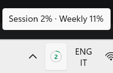
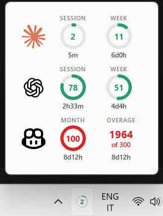
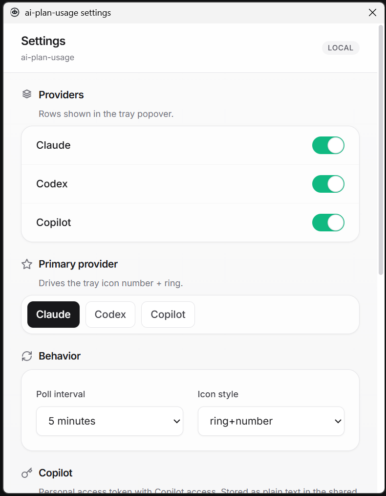

<p align="center">
  
</p>

<h1 align="center">ai-plan-usage</h1>

<p align="center">
  A small Windows tray app for Claude, Codex, and GitHub Copilot plan usage.
</p>

<p align="center">
  Minimal interface. Local data. No dashboards. No terminal workflow for checking usage.
</p>

## Why

`ai-plan-usage` is for people who use AI plans every day and just want to monitor how much of their plan they got left.

It stays out of the way, lives in the tray, and shows only the usage signals that matter:

- Claude session and weekly usage
- Codex session and weekly usage
- GitHub Copilot monthly usage and overage
- reset countdowns
- a dynamic tray icon for the account you care about most

Daily use is handled through the UI. Click the tray icon, check the popover, adjust settings when needed, and get back to work.

## Easy Tray Readout

The tray icon shows the selected primary account at a glance. The number and ring are designed for quick checking, and the tooltip gives the current session and weekly percentages without opening a full window.

<p align="center">
  
</p>

## Compact Usage Popover

The popover shows each enabled account in one compact view. Claude and Codex show session and weekly usage; Copilot shows monthly usage and overage. Reset countdowns are visible where they matter.

<p align="center">
  
</p>

## Simple Settings

Settings are plain and practical: add and order accounts, pick the one behind the tray icon, point the app at Meridian, set the polling interval and change the icon style.

<p align="center">
  
</p>

## Features

- **Claude, Codex, and GitHub Copilot** usage in one tray app.
- **Account toggles** so the popover only shows what you use.
- **Primary account selection** for the tray icon number and ring.
- **Configurable refresh interval** with a 5 minute default.
- **Several accounts per provider**, each with its own name, order and toggle.
- **Claude from Meridian or a direct sign-in**, Codex from a browser sign-in, Copilot from a pasted token or a login copied from OpenCode. The Claude Code and Codex CLIs are not needed.
- **Local settings** under `%APPDATA%\ai-plan-usage\`, tokens included, in plain text.
- **Pace-aware coloring** for the tray icon and popover (see `docs/coloring.md`).
- **No hosted backend** for your usage data.
- **No analytics dashboard** or historical reporting layer.

## Run

```powershell
cd apps/ui
npm install

cd ..\tauri
npm install
npm run dev
```

## Build

```powershell
scripts\build-tauri.ps1
```

The build output is mirrored into `artifacts/`.

## GitHub Actions

The desktop build workflow runs on `windows-latest` so the app builds as a real Windows `.exe` without Linux cross-compilation setup.

- Every push, pull request, and manual run uploads a `windows-desktop-exes` artifact.
- Tags that start with `v` also create or update a GitHub Release and upload the `.exe`.
